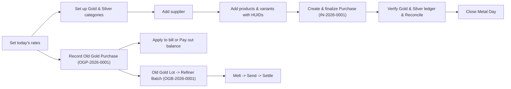

# Amman Jewellers - Inventory Flow User Manual

This manual walks you through the whole **Inventory** module in JewelTrackerPro, one screen at a
time: set today's metal and old-gold buying rates, set up Gold & Silver categories, add a
supplier, add standalone products and variant designs with hallmark IDs (HUID), record and
finalize a purchase (inward), reconcile and close the daily Gold & Silver ledger, buy old gold
from a customer, and settle unclaimed old gold through a refiner batch.

Every step uses the **same sample shop, date, supplier, products, purchase, stock ledger, and
old-gold records**, so the numbers you see here match what the software shows. You can copy these
examples the first time you practice.

> Dates are shown in the app as `9 Oct 2026` (day, 3-letter month, year). This manual uses the
> same format. Gold and silver weights are shown to three decimals (milligrams).

> Building a sale bill from these products is covered in the
> [Billing flow user manual](billing-user-manual.md), and monthly schemes are covered in the
> [Gold Savings user manual](gold-savings-user-manual.md).

## The sample data used in this manual

**Shop and rates** (the same shop and date as the billing manual):

| Item | Value |
| --- | --- |
| Shop | Amman Jewellers |
| Business date | 9 Oct 2026 |
| Gold 24K selling rate | Rs. 7,640 / g |
| Gold 22K selling rate | Rs. 7,000 / g |
| Gold 20K selling rate | Rs. 6,370 / g |
| Gold 18K selling rate | Rs. 5,730 / g |
| Fine silver (999) selling rate | Rs. 98 / g |
| 925 silver selling rate | Rs. 91 / g |
| Old gold 22K buying rate | Rs. 6,800 / g |

**Gold & Silver categories (`Inventory > Gold & Silver`):**

| Category | Metal | Initial opening on 9 Oct 2026 | Opening after product creation |
| --- | --- | --- | --- |
| `Chain` | Gold | `0.000 g` | `16.000 g` (from 2 pcs of Rope Chain) |
| `Ring` | Gold | `0.000 g` | `6.500 g` (from 2 variant pcs of Lakshmi Ring) |
| `Bangle` | Gold | `0.000 g` | `0.000 g` |

**Supplier (`Inventory > Suppliers`):**

| Field | Sample value |
| --- | --- |
| Name | `Lakshmi Bullion & Co` |
| Phone | `9443011223` |
| GSTIN | `33AABCL1234F1Z5` |
| Address | `45, Big Bazaar Street, Coimbatore` |
| Notes | `Wholesale chains and bullion refiner` |

**Products and variants (`Inventory > Products`):**

| Item | Type | Category | Metal / Purity | Gross wt | Stone wt | Net wt | Making | Initial stock | HUIDs |
| --- | --- | --- | --- | --- | --- | --- | --- | --- | --- |
| `Rope Chain` | Standalone product | `Chain` | Gold 22K | 8.250 g | 0.000 g | 8.000 g | Rs. 0.00 | 2 pcs | `AB12C3`, `AB12C4` |
| `Lakshmi Ring` | Parent design | `Ring` | Gold 22K | 0.000 g | 0.000 g | 0.000 g | Rs. 0.00 | 0 pcs (rolls up to 2 pcs) | - |
| `Lakshmi Ring / 4g / Size 14` (`LR-14`) | Variant of Lakshmi Ring | `Ring` | Gold 22K | 4.300 g | 0.300 g | 4.000 g | Rs. 1,500.00 | 1 pc | `RG45T7` |
| `Lakshmi Ring / 2.5g / Size 16` (`LR-16`) | Variant of Lakshmi Ring | `Ring` | Gold 22K | 2.700 g | 0.200 g | 2.500 g | Rs. 900.00 | 1 pc | `RG45T8` |

**Purchase / Inward (`Inventory > Purchase`):**

Document `IN-2026-0001` from `Lakshmi Bullion & Co` on `9 Oct 2026`, payment mode `UPI`:

| Line | Kind | Item / Category | Purity | Qty | Gross wt | Net wt | Rate / g | Making | HUID | Line amount |
| --- | --- | --- | --- | --- | --- | --- | --- | --- | --- | --- |
| 1 | Product | `Rope Chain` (`Chain`) | 22K | 1 pc | 8.250 g | 8.000 g | Rs. 6,600 | Rs. 400 | `AB12C5` | Rs. 53,200.00 |
| 2 | Raw metal | Gold - `Bangle` | 22K | 1 | 20.000 g | 20.000 g | Rs. 6,600 | Rs. 0 | - | Rs. 1,32,000.00 |

| Purchase summary | Value |
| --- | --- |
| Total net weight | `28.000 g` |
| Taxable subtotal | Rs. 1,85,200.00 |
| CGST 1.5% | Rs. 2,778.00 |
| SGST 1.5% | Rs. 2,778.00 |
| Round off | Rs. 0.00 |
| **Grand total** | **Rs. 1,90,756.00** |

Piece stock increases only through **Purchase** or **Add stock** on a product (same purchase
flow). There is no separate Adjust stock screen.

**Gold & Silver ledger on 9 Oct 2026 (after sample sale bill `TI-2026-0001`):**

On `TI-2026-0001` (from the billing manual), the shop sells `1 pc` of `Rope Chain` (`8.000 g`,
HUID `AB12C3`) and `1 pc` of `Lakshmi Ring / 4g / Size 14` (`4.000 g`, HUID `RG45T7`):

| Category | Opening (g) | Inward (g) | Adjustment net (g) | Sales (g) | Closing (g) | Piece implied (g) | Raw inward (g) | Unexplained (g) |
| --- | --- | --- | --- | --- | --- | --- | --- | --- |
| `Chain` | 16.000 | 8.000 | 0.000 | 8.000 | **16.000** | 16.000 (2 pcs) | 0.000 | 0.000 (OK) |
| `Ring` | 6.500 | 0.000 | 0.000 | 4.000 | **2.500** | 2.500 (1 pc) | 0.000 | 0.000 (OK) |
| `Bangle` | 0.000 | 20.000 | 0.000 | 0.000 | **20.000** | 0.000 (0 pcs) | 20.000 | 0.000 (OK) |
| **Total Gold** | **22.500** | **28.000** | **0.000** | **12.000** | **38.500** | **18.500** | **20.000** | **0.000** |

**Old Gold Purchase (`Inventory > Old Gold Purchase`):**

Document `OGP-2026-0001` on `9 Oct 2026` for customer `Meenakshi S` (`9876543210`):

| Field | Sample value |
| --- | --- |
| Description | `Old chain` |
| Metal / Purity | Gold 22K |
| Gross weight | `11.000 g` |
| Stone weight | `1.000 g` |
| Net weight | `10.000 g` |
| Touch % | `80%` (valued fine weight = `10.000 x 80% = 8.000 g`) |
| Rate per gram | Rs. 6,800 / g |
| Gross value | Rs. 54,400.00 (`8.000 g x Rs. 6,800`; if Touch % is left blank, uses full `10.000 g` net weight) |
| Deduction % | `2%` (Rs. 1,088.00) |
| **Final value (Purchase amount)** | **Rs. 53,312.00** |

**Old Gold Lot & Refiner Batch (`Inventory > Old Gold Lot`):**

Batch `OGB-2026-0001` on `9 Oct 2026`, refiner `Lakshmi Bullion & Co`:

| Stage | Sample value |
| --- | --- |
| Unbatched item selected | `OGP-2026-0001` (`Old chain`, gross `11.000 g`, net `10.000 g`, expected fine `8.000 g`, cost Rs. 53,312.00) |
| **Melt** (9 Oct 2026) | Melted weight `10.850 g` |
| **Send** (9 Oct 2026) | Sent weight `10.850 g` |
| **Settle** (9 Oct 2026) | Fine weight received `7.950 g` at Rs. 6,800 / g (Rs. 54,060.00) + Cash received Rs. 500.00 = Rs. 54,560.00 |
| **Gain / loss** | `Rs. 54,560.00 - Rs. 53,312.00` = **+Rs. 1,248.00** |

## Flow at a glance

---

## 1. Overview of the Inventory Module

Menu path: **Inventory** in the left sidebar. The compact top bar has six tabs:

| Tab | Route | Permission key | What it is for |
| --- | --- | --- | --- |
| **Products** | `/inventory/products` | `products` | Jewellery catalogue, variants, piece stock, HUID tags, and manual stock adjustments |
| **Gold & Silver** | `/inventory/stock` | `stock` | Daily category weight ledger (Opening, Inward, Sales, Closing), reconciliation, and day close |
| **Purchase** | `/inventory/inwards` | `inward` | Supplier purchases (`IN-<year>-<seq>`) for both catalogue products and raw metal |
| **Old Gold Purchase** | `/inventory/old-gold` | `inward` | Customer old-gold buying bills (`OGP-<year>-<seq>`), bill linking, and customer payouts |
| **Old Gold Lot** | `/inventory/old-gold-lot` | `inward` | Unclaimed old-gold pool and refiner batches (`OGB-<year>-<seq>`: Melt, Send, Settle) |
| **Suppliers** | `/inventory/suppliers` | `inward` | Vendors and refiners used in Purchase and Old Gold Lot |

### Who can do what

| Action | Staff (with feature permission) | Admin |
| --- | --- | --- |
| View and manage Products, Stock, Purchases, Old Gold, Suppliers | Yes | Yes |
| Close a Gold or Silver day (`Close Day`) | Yes | Yes |
| Reopen a closed Gold or Silver day (`Reopen day`) | No | Yes |

### How piece stock and weight ledger work together

JewelTrackerPro keeps **one unified `stock_movements` ledger** behind the scenes:

1. **Catalogue products (`Products` tab)** track **piece count (`stockQty`)** and **HUIDs**, and
   automatically write their net weight (`qty x netWeight`) into the matching metal and category.
2. **Raw metal lines on a Purchase (`Purchase` tab)** have no product or piece count; they add
   weight directly to the category's **Inward (g)** column.
3. **Old Gold Purchases (`Old Gold Purchase` and `Old Gold Lot`)** are customer exchange / scrap
   records. They **never** add pieces to `Products` and **never** add weight to `Gold & Silver`
   retail stock, even when a refiner batch is settled.

---

## Step 1 - Set today's metal and old-gold buying rates

Menu: **Gold & Silver Rates**

Before adding old-gold purchases or billing items, confirm the rates for `9 Oct 2026`.

1. Check the **date** at the top of the page: `9 Oct 2026`.
2. Enter the daily selling rates per gram:

   | Card | Sample rate |
   | --- | --- |
   | 24K GOLD | `7,640` |
   | 22K GOLD | `7,000` |
   | 20K GOLD | `6,370` |
   | 18K GOLD | `5,730` |
   | FINE SILVER (999) | `98` |
   | 925 SILVER | `91` |

3. In the **Old gold buying rates** section, set the 22K buying rate to `6,800` (if an old-gold
   buying rate is left at `0`, the app falls back to that purity's selling rate).
4. Click **Save**.

---

## Step 2 - Set up categories in Gold & Silver Stock

Menu: **Inventory > Gold & Silver**

Every product in the catalogue must belong to a category from your Gold & Silver stock sheet
(if no categories exist yet, the product form shows the hint *"Manage categories in Stock first,
then add products."*).

1. At the top of **Gold & Silver Stock**, confirm the date picker shows `9 Oct 2026` and the
   status badge next to it says **Open**.
2. Make sure the **Gold** toggle is selected in the **Stock by Category** tab.
3. Click **Add Category**. In the **Add Category** modal, enter:

   | Field | Sample value | Notes |
   | --- | --- | --- |
   | Category Name | `Chain` | Required, unique across categories |
   | Opening Weight (g) | `0` | We will bring in initial weight via product creation in Step 4 |
   | Sales Override (g) | leave blank | Optional manual override |

4. Click **Add Category**.
5. Repeat **Add Category** to create `Ring` (Opening Weight `0`) and `Bangle` (Opening Weight `0`).

> **Tip:** If your shop already has loose or untagged category weight on day one that is not
> entered as individual products, you can type that starting weight directly into **Opening
> Weight (g)**. When you later create products with initial stock on the same date, the app adds
> their opening snapshot (`stockQty x netWeight`) on top of any base opening you saved.

---

## Step 3 - Add a supplier

Menu: **Inventory > Suppliers**

Suppliers are used both when buying new stock (**Purchase**) and when sending old gold to a
refiner (**Old Gold Lot**).

> You may notice a built-in row named **Stock addition** with a `System` badge and `Protected`
> in the Action column. It is a protected system supplier and cannot be edited or deleted.

1. Click **Add supplier** in the top right.
2. Fill in the **Add supplier** modal:

   | Field | Sample value | Notes |
   | --- | --- | --- |
   | Name | `Lakshmi Bullion & Co` | Required (Save stays disabled until filled) |
   | Phone | `9443011223` | Optional |
   | GSTIN | `33AABCL1234F1Z5` | Optional; auto-uppercases letters and digits up to 20 chars |
   | Address | `45, Big Bazaar Street, Coimbatore` | Optional |
   | Notes | `Wholesale chains and bullion refiner` | Optional |

3. Click **Save**. A toast confirms *"Supplier added"*, and `Lakshmi Bullion & Co` appears in the
   table.
4. You can edit a supplier anytime with the pencil icon, or delete a supplier with the trash icon
   (a supplier can only be deleted if it has no purchases linked to it).

---

## Step 4 - Add products, variants, and HUIDs

Menu: **Inventory > Products**

The Products page lets you manage standalone items as well as **parent designs with multiple
size/weight variants**.

### 4.1 Add a standalone product (`Rope Chain`)

1. Click **Add product** in the top right. The **Add product** modal opens with four sections.
2. Fill in each section:

   **Section 1 - Product information**

   | Field | Sample value |
   | --- | --- |
   | Product name | `Rope Chain` |
   | SKU / Variant code | leave blank (optional unique code) |
   | Product image | optional (PNG or JPEG, max 2MB; automatically downscaled) |

   **Section 2 - Classification**

   | Field | Sample value |
   | --- | --- |
   | Metal | `Gold` |
   | Category | `Chain` |
   | Purity | `22K` |

   **Section 3 - Weight & pricing**

   | Field | Sample value |
   | --- | --- |
   | Gross weight (g) | `8.250` |
   | Net weight (g) | `8.000` |
   | Stone weight (g) | leave blank (`0`) |
   | Making charges (Rs.) | leave blank (`0`) |

   **Section 4 - Stock & variant**

   | Field | Sample value |
   | --- | --- |
   | Stock quantity (pcs) | `2` |
   | Size | leave blank |
   | Stone details | leave blank |
   | HUID (Hallmark Unique ID) | Row 1: `AB12C3`, Row 2: `AB12C4` (*2 of 2 pieces tagged*) |
   | Active | ticked (*Visible in billing and inventory*) |
   | Custom attributes | optional (click **Add** to store key/value pairs like `Finish` = `Glossy`) |

3. Click **Save product**.
   - Because `Stock quantity` is `2`, the software records an **opening movement** of `2 pcs` and
     `16.000 g` (`2 x 8.000 g`) under `Gold > Chain`.

### 4.2 Add a parent design with variants (`Lakshmi Ring`)

When a design comes in multiple sizes or weights, create the **parent design** with `0` stock
first, then add its **sellable variants** underneath.

1. Click **Add product** and create the parent design:

   | Field | Sample value |
   | --- | --- |
   | Product name | `Lakshmi Ring` |
   | Metal / Category / Purity | `Gold` / `Ring` / `22K` |
   | Gross weight / Net weight | `0` / `0` |
   | Stock quantity (pcs) | `0` (*No HUID needed while stock is 0.*) |
   | Active | ticked |

2. Click **Save product**.
3. In the Products table, click the **Lakshmi Ring** row to open its **Product Detail** modal,
   then click **Add variant** in the top-right action bar.
4. The **Add variant** modal opens (*"Add a sellable variant of Lakshmi Ring"*). Notice that
   **Metal** (`Gold`) and **Category** (`Ring`) are locked to match the parent design. Fill in
   **Variant A**:

   | Field | Sample value |
   | --- | --- |
   | Product name | `Lakshmi Ring` (pre-filled) |
   | SKU / Variant code | `LR-14` |
   | Purity | `22K` |
   | Gross weight (g) | `4.300` |
   | Net weight (g) | `4.000` |
   | Stone weight (g) | `0.300` |
   | Making charges (Rs.) | `1,500` |
   | Stock quantity (pcs) | `1` |
   | Size | `14` |
   | Stone details | `1 ruby stone, prong set` |
   | HUID | `RG45T7` |

5. Click **Save product**.
6. Click **Lakshmi Ring** again, click **Add variant**, and add **Variant B**:

   | Field | Sample value |
   | --- | --- |
   | SKU / Variant code | `LR-16` |
   | Purity | `22K` |
   | Gross weight (g) | `2.700` |
   | Net weight (g) | `2.500` |
   | Stone weight (g) | `0.200` |
   | Making charges (Rs.) | `900` |
   | Stock quantity (pcs) | `1` |
   | Size | `16` |
   | Stone details | `1 ruby stone, prong set` |
   | HUID | `RG45T8` |

7. Click **Save product**.

### 4.3 How the Products page displays your catalogue

- **KPI cards at the top** count only **sellable items** (standalone products + child variants,
  excluding parent containers):
  - **Total products:** `3` (`Rope Chain`, `Lakshmi Ring / 4g / Size 14`, `Lakshmi Ring / 2.5g / Size 16`)
  - **Gold products:** `3` (`100% of total`)
  - **Silver products:** `0` (`0% of total`)
  - **Low stock:** items with `1` to `5` pieces in stock (click **View low stock** to filter).
- **Parent roll-up:** In the table and grid views, the parent `Lakshmi Ring` row displays a
  `2 variants` pill and rolls up the total stock of its children (`2` pcs), while each indented
  variant row underneath shows its own formatted name (`Lakshmi Ring / 4g / Size 14`), code
  (`LR-14`, `LR-16`), weights, and stock (`1` pc each).
- **Filters and views:** Filter by Metal pills (`All`, `Gold`, `Silver`), Category dropdown,
  Purity dropdown, Stock status (`In stock` for 6+ pcs, `Low stock` for 1-5 pcs, `Out of stock`
  for 0 pcs), or switch between **Table** and **Grid** view.
- **Deleting a design with variants:** You cannot delete `Lakshmi Ring` while `LR-14` or `LR-16`
  exist. The app warns: *"This design has variants. Delete the variants first."*

---

## Step 5 - Record and finalize a purchase (Inward)

Menu: **Inventory > Purchase**

When new jewellery pieces or raw bullion arrive from a supplier, record a **Purchase**. A
purchase can contain two kinds of lines:

- **Product line:** linked to a catalogue product. Finalizing adds **piece stock (`qty`)** and
  **HUIDs** to that product, and adds **`qty x netWeight`** to the category's **Inward (g)**.
- **Raw metal line:** not linked to a product (`Weight only`). Finalizing adds **`qty x
  netWeight`** directly to the category's **Inward (g)** without changing product piece counts.

> **Shortcut from Products:** You can also tick one or more checkboxes on **Inventory >
> Products** and click **Add inward stock** (or open a product's detail modal and click **Add
> stock**). That opens the exact same **New purchase** modal with those product lines pre-filled.

### 5.1 Create the purchase (`IN-2026-0001`)

1. Go to **Inventory > Purchase** and click **New purchase**.
2. In **Step 1 - Purchase details**, fill in:

   | Field | Sample value | Notes |
   | --- | --- | --- |
   | Supplier | `Lakshmi Bullion & Co` | Or click **+ New** to create a supplier on the spot |
   | Date | `9 Oct 2026` | Must be an **Open** metal day |
   | Payment | `UPI` | Options: `Cash`, `UPI`, `Card` |
   | Notes | `Invoice LB-409` | Optional supplier bill reference |

3. In **Step 2 - Purchase lines**, fill in the first line (which starts as a **Product** line):

   | Field | Sample value |
   | --- | --- |
   | Kind | `Product` |
   | Product | `Rope Chain` (auto-fills Metal `Gold`, Category `Chain`, Purity `22K`, Gross `8.250 g`, Net `8.000 g`) |
   | Qty | `1` pcs |
   | Gross weight | `8.250` g |
   | Net weight | `8.000` g |
   | Rate | `6,600` (Rs. / g) |
   | Making | `400` (Rs. per piece) |
   | HSN | `7113` (default) |
   | HUID | `AB12C5` (*1 of 1 pieces*) |

   **Line 1 calculation:**
   \[\text{Line amount} = (8.000 \times 6,600 + 400) \times 1 = \text{Rs. } 53,200.00\]

4. Click **+ Raw metal** at the top right of the **Purchase lines** section to add a second line
   for uncrafted bangle gold:

   | Field | Sample value |
   | --- | --- |
   | Kind | `Raw metal` |
   | Metal | `Gold` |
   | Category | `Bangle` |
   | Purity | `22K` |
   | Qty | `1` pcs |
   | Gross weight | `20.000` g |
   | Net weight | `20.000` g |
   | Rate | `6,600` (Rs. / g) |
   | Making | `0` |
   | HSN | `7113` |

   **Line 2 calculation:**
   \[\text{Line amount} = (20.000 \times 6,600 + 0) \times 1 = \text{Rs. } 1,32,000.00\]

5. Review the **Purchase totals** box at the bottom of the modal:

   | Row | Formula | Sample value |
   | --- | --- | --- |
   | Total weight | `8.000 + 20.000` | `28.000 g` |
   | Taxable | `53,200.00 + 1,32,000.00` | `Rs. 1,85,200.00` |
   | CGST 1.5% | `1,85,200.00 x 1.5%` | `Rs. 2,778.00` |
   | SGST 1.5% | `1,85,200.00 x 1.5%` | `Rs. 2,778.00` |
   | Round off | auto rounds to nearest rupee (editable) | `Rs. 0.00` |
   | **Grand total** | `1,85,200 + 2,778 + 2,778` | **Rs. 1,90,756.00** |

### 5.2 Save as draft vs Finalize

- **Save draft:** Stores the purchase with number `IN-2026-0001` and status `Draft`. A draft
  **does not** change product piece counts, HUIDs, or Gold & Silver weights yet. On the Purchase
  list, the summary line reminds you: *"1 draft not in stock yet"*. You can edit, print, finalize,
  or delete a draft.
- **Save & finalize** (or click **Finalize** on the Purchase list): Opens a confirmation dialog:
  *"Finalizing adds piece stock on products and purchase weight on Gold & Silver. This cannot be
  edited afterwards."*

Click **Save & finalize**, then confirm **Finalize**.

**What changes immediately after finalizing `IN-2026-0001`:**

| Where | Before finalize | After finalize |
| --- | --- | --- |
| Purchase `IN-2026-0001` status | `Draft` (editable) | `Final` (read-only; view with eye icon or print with printer icon) |
| `Rope Chain` stock (`Products`) | `2 pcs` (`AB12C3`, `AB12C4`) | `3 pcs` (`AB12C3`, `AB12C4`, `AB12C5`) |
| `Gold > Chain` Inward weight | `0.000 g` | `8.000 g` |
| `Gold > Bangle` Inward weight | `0.000 g` | `20.000 g` |

---

## Step 6 - Add stock (purchase only)

Menu: **Inventory > Products**, open a product, then click **Add stock** — or use
**Inventory > Purchase**.

Piece stock is added only through a purchase. There is no separate Adjust stock screen for
adding or reducing quantity outside purchase and sales.

---

## Step 7 - Daily Gold & Silver ledger, reconciliation, and day close

Menu: **Inventory > Gold & Silver**

Now let us see how all movements on `9 Oct 2026` come together on the **Gold & Silver Stock**
page. In addition to the steps above, assume the shop has finalized the sample Tax Invoice
`TI-2026-0001` from the [Billing flow user manual](billing-user-manual.md), which sold:

- `1 pc` of `Rope Chain` (`8.000 g`, HUID `AB12C3`)
- `1 pc` of `Lakshmi Ring / 4g / Size 14` (`4.000 g`, HUID `RG45T7`)

### 7.1 Top summary cards

At the top of **Gold & Silver Stock**, two summary cards show the day's totals for **Gold** and
**Silver**. For **Gold Stock Summary** on `9 Oct 2026`:

- **Opening:** `22.500 g` (`16.000 g` Chain + `6.500 g` Ring)
- **Inward:** `28.000 g` (`8.000 g` Chain + `20.000 g` Bangle)
- **Sales:** `12.000 g` (`8.000 g` Chain + `4.000 g` Ring)
- **Closing:** `38.500 g` (`22.500 + 28.000 - 12.000 sales`)

### 7.2 Tab 1 - Stock by Category

This is the main daily ledger table. For **Gold** on `9 Oct 2026`, it shows:

| # | CATEGORY | OPENING (G) | INWARD (G) | SALES (G) | CLOSING (G) |
| --- | --- | --- | --- | --- | --- |
| 01 | `Chain` | 16.00 | 8.00 | 8.00 | 16.00 |
| 02 | `Ring` | 6.50 | 0.00 | 4.00 | 2.50 |
| 03 | `Bangle` | 0.00 | 20.00 | 0.00 | 20.00 |

- **Drill down into Inward or Sales:**
  - Click `8.00` in the **INWARD (G)** column on `Chain` to open the **Inward — Chain** modal: it
    lists document `IN-2026-0001`, date `9 Oct 2026`, item `Rope Chain`, Qty `1`, Weight
    `8.000 g`.
  - Click `8.00` in the **SALES (G)** column on `Chain` to open the **Sales — Chain** modal: it
    lists document `TI-2026-0001` (clickable link to the bill), date `9 Oct 2026`, item `Rope
    Chain`, Qty `1`, Weight `8.000 g`.
- **Edit a category / Sales Override:**
  - Click the pencil icon on a row to edit its **Category Name**, **Opening Weight (g)**, or set
    a manual **Sales Override (g)**.
  - If you enter a **Sales Override (g)**, you **must** enter an **Override reason** (*"Why is
    auto sales being replaced?"*).
  - Clicking **Auto Calculate Sales** in the toolbar clears all manual sales overrides for that
    date and metal so the sheet returns to live bill totals.
- **Carry-forward to the next day:** Tomorrow (`10 Oct 2026`), each category's **Opening (g)**
  automatically starts at today's **Closing (g)** (`8.000 g` Chain, `2.500 g` Ring, `20.000 g`
  Bangle) unless you manually save a different opening for tomorrow.

### 7.3 Tab 2 - Closing Summary

Shows a clean, printable table of both **Gold** and **Silver** on one screen:

- Toggle between **All** (every category) and **Transacted** (only categories that had inward or
  sales movement today).
- Click **Print summary** to open the print preview or save as PDF.

### 7.4 Tab 3 - Inward Stock

Lists all purchases for the selected date (`9 Oct 2026`) and metal (`Gold`).

- Click the row for `IN-2026-0001` (`Lakshmi Bullion & Co`, total weight `28.000 g`, total amount
  `Rs. 1,90,756.00`, status `final`) to expand its line items (`Rope Chain` and `Weight only` raw
  metal under `Bangle`).

### 7.5 Tab 4 - Pieces Today

Shows piece movements (`In`, `Out`, `Net`) from finalized purchases and finalized sale bills on
`9 Oct 2026`:

| Product | In | Out | Net |
| --- | --- | --- | --- |
| `Lakshmi Ring` (Size 14) | 0 | 1 | -1 |
| `Rope Chain` | 1 | 1 | 0 |

### 7.6 Tab 5 - Stock History

Shows up to 90 business dates with saved openings, finalized inwards, finalized sales, or closed
day snapshots, with **Date**, **Opening**, **Inward**, **Sales**, and **Closing** totals. Click
any date (`9 Oct 2026`) to jump back to that day's **Stock by Category** view.

### 7.7 Tab 6 - Reconciliation

Compares each category's **Ledger close** against the weight implied by current product piece
stock (`netWeight x stockQty`) plus **Raw inward** on that date:

\[\text{Unexplained} = \text{Ledger close} - \text{Piece implied} - \text{Raw inward}\]

| Metal | Category | Ledger close | Piece implied | Raw inward | Unexplained | Status |
| --- | --- | --- | --- | --- | --- | --- |
| Gold | `Chain` | 8.000 g | 8.000 g | 0.000 g | 0.000 g | `OK` |
| Gold | `Ring` | 2.500 g | 2.500 g | 0.000 g | 0.000 g | `OK` |
| Gold | `Bangle` | 20.000 g | 0.000 g | 20.000 g | 0.000 g | `OK` |

If `Unexplained` ever exceeds `0.100 g`, the status badge turns to **Drift** so you can
investigate immediately.

### 7.8 Close the Metal Day (and Admin Reopen)

At the end of business on `9 Oct 2026`:

1. Click **Close Day** in the top-right header of **Gold & Silver Stock**.
2. The **Close Gold day — 9 Oct 2026** modal runs an automatic precheck:
   - If there are any **open draft bills** or **open draft purchases (inwards)** for Gold on
     `9 Oct 2026`, closing is **blocked** with: *"Cannot close: X open draft bills and Y open
     inwards for Gold on this date. Finalize or delete them first."*
   - When all drafts are cleared, it shows: *"Ready to close. 1 due entries dated today
     (informational)."*
3. Enter an optional **Note** (for example `Tallied vault trays with Meenakshi`) and click
   **Close day**.
4. What closing does:
   - Snapshots Opening, Inward, Sales, and Closing weights for every category on `9 Oct 2026`.
   - Runs an automatic **day-close database backup** and shows *"Gold day closed and backed up"*.
   - Changes the header badge from **Open** to **Closed**.
   - **Locks `9 Oct 2026` for Gold:** nobody can edit category weights, finalize or cancel a Gold
     bill, finalize a Gold purchase, or post a Gold stock adjustment dated `9 Oct 2026`.
5. **Reopening a closed day (Admin only):**
   - If a late correction is needed, an **Admin** user sees a **Reopen day** button in the top
     right.
   - Click **Reopen day**, enter a mandatory **Reason** (for example `Late purchase bill entry`),
     and confirm. The snapshot is removed so the ledger recomputes from live bills and purchases.

---

## Step 8 - Old gold purchase and customer payouts

Menu: **Inventory > Old Gold Purchase**

When a customer sells or exchanges old gold jewellery, record an **Old Gold Purchase**. Unlike a
supplier Purchase (`IN-...`), an Old Gold Purchase **does not** add stock to `Products` or `Gold
& Silver`. Instead, it creates a customer credit document (`OGP-<year>-<seq>`) whose balance can
be **applied to a sale bill**, **paid out in cash/UPI/bank**, or **both**.

### 8.1 Create and finalize `OGP-2026-0001`

1. Go to **Inventory > Old Gold Purchase** and click **New purchase** (you can also start this
   directly from the Old Gold section inside a sale bill editor).
2. In **Step 1 - Purchase details** (shows preview number `Bill OGP-2026-0001`), fill in:

   | Field | Sample value |
   | --- | --- |
   | Customer | Search and select `Meenakshi S` (`9876543210`) |
   | Date | `9 Oct 2026` |
   | Customer name | `Meenakshi S` (auto-filled and locked when a customer is selected) |
   | Phone | `9876543210` (auto-filled) |
   | Notes | `Customer old rope chain` |

3. In **Step 2 - Purchase items**, fill in the old gold row:

   | Field | Sample value | Notes |
   | --- | --- | --- |
   | Item name | `Old chain` | Required if weight is entered |
   | G.W (Gross wt, g) | `11.000` | Total weight on scale |
   | St.Wt (Stone / deduction wt, g) | `1.000` | Deducted from gross weight |
   | Net (Net wt, g) | `10.000` | Auto-computed as `Gross - Stone` (`11.000 - 1.000`), or editable |
   | Purity | `22K` | Sets metal to `Gold` and pre-fills the 22K buying rate |
   | Rate/g (Rs.) | `6,800` | Pre-filled from Old Gold Buying Rates |
   | Ded % (Deduction %) | `2` | Melting / wastage deduction % |
   | Touch % | `80` | Optional assay purity %; when set above `0`, values the item on **Fine wt** (`10.000 x 80% = 8.000 g`) and stores `8.000 g` for refiner tracking |

   **How the software calculates the old gold value:**
   - **Valued weight (Fine wt):** \(10.000 \text{ g} \times 80\% = 8.000 \text{ g}\) (if Touch % is left blank, the full `10.000 g` net weight is used)
   - **Gross value:** \(8.000 \text{ g} \times \text{Rs. } 6,800 = \text{Rs. } 54,400.00\)
   - **Deduction (2%):** \(\text{Rs. } 54,400.00 \times 2\% = \text{Rs. } 1,088.00\)
   - **Final value (Amount):** \(\text{Rs. } 54,400.00 - \text{Rs. } 1,088.00 = \text{Rs. } 53,312.00\)

4. Click **Save & finalize**.
5. In the **Finalize old gold purchase?** dialog:
   - You can tick **Pay the balance out to the customer now** if you are handing over the cash/UPI
     immediately at the counter.
   - Leave it unticked for now and click **Finalize** so we can see all settlement options.

Once finalized, `OGP-2026-0001` appears on the Old Gold Purchase list with:
- **Status:** `Final`
- **Amount:** `Rs. 53,312.00`
- **Paid out:** `Rs. 0.00`
- **Balance:** `Rs. 53,312.00`

### 8.2 Three ways to settle or manage `OGP-2026-0001`

#### Option A - Apply the balance to a sale bill

1. Open a sale bill in **Billing** for `Meenakshi S`.
2. In the **Old Gold Purchase** linker on the bill, `OGP-2026-0001` appears with its available
   balance (`Rs. 53,312.00`). Click **Apply**.
3. You can apply the full `Rs. 53,312.00` or edit the applied amount down (for example `Rs.
   40,000.00`). Any remaining balance (`Rs. 13,312.00`) stays on `OGP-2026-0001` to be applied to
   another bill or paid out later.
4. Note: once an old-gold purchase is linked to a sale bill, its items are **claimed** by that
   bill and will **not** appear in the **Old Gold Lot** for refiner melting.

#### Option B - Pay out the balance to the customer (and Void a payout)

If the customer is selling old gold for money (or wants the leftover balance paid out):

1. On **Inventory > Old Gold Purchase**, click the **wallet icon (`Pay out OGP-2026-0001`)** on
   the row.
2. In the **Pay out OGP-2026-0001** modal:

   | Field | Sample value |
   | --- | --- |
   | Date | `9 Oct 2026` |
   | Mode | `UPI` (options: `Cash`, `UPI`, `Bank / cheque`) |
   | Amount | `53,312` (defaults to the remaining balance) |
   | Note | `Paid via GPay` |

   > **Section 40A(3) cash warning:** If you choose `Cash` and the amount is **Rs. 10,000 or
   > more**, the modal displays a yellow warning banner: *"A cash payout of Rs. 53,312.00 may
   > need the customer's PAN, and cash above Rs 10,000 a day is restricted under section
   > 40A(3)."*

3. Click **Record payout**. The purchase now shows **Paid out:** `Rs. 53,312.00` and **Balance:**
   `Rs. 0.00`.
4. **Voiding a payout:** If a payout was recorded by mistake, click the **eye icon (`View`)** on
   `OGP-2026-0001`, scroll to **Step 3 - Settlement > Payouts**, and click **Void** next to the
   payout. Enter a reason (for example `Entered wrong mode`) and confirm **Void payout**. The
   money returns to the purchase **Balance**.

#### Option C - Cancel an unused Old Gold Purchase

If `OGP-2026-0001` is not applied to any bill, has no active payouts, and none of its items are
in a refiner batch, a **ban icon (`Cancel`)** appears in the Action column. Click it, enter a
reason, and confirm **Cancel purchase**. The number `OGP-2026-0001` stays used, and its status
becomes `Cancelled`.

---

## Step 9 - Old gold lot and refiner batches

Menu: **Inventory > Old Gold Lot**

Every finalized old-gold purchase item that has **not** been claimed by a sale bill sits in the
**Old Gold Lot**, grouped by metal (`Gold`, `Silver`). From here, you gather unclaimed old gold
into a **Refiner Batch (`OGB-<year>-<seq>`)** and track it through four stages:
**Open -> Melted -> Sent -> Settled**.

> **Important:** Settling a refiner batch records the financial gain or loss against what you
> paid the customer. Received fine metal is for settlement accounting only and **never** adds to
> your `Gold & Silver` retail stock. (If the refiner gives you bullion back that you want to
> bring into shop stock, record a regular **Purchase** in Step 5.)

### 9.1 Create refiner batch `OGB-2026-0001`

Assuming `OGP-2026-0001` (`Old chain`, paid out to `Meenakshi S`, not linked to a sale bill) is in
the lot:

1. Go to **Inventory > Old Gold Lot**.
2. At the top, the stat card shows:
   - **Gold lot · 1 item:** `11.000 g · Rs. 53,312.00`
3. Under **Unbatched items**, you see:

   | Purchase | Date | Customer | Item | Metal | Gross (g) | Net (g) | Fine (g) | Purity | Cost |
   | --- | --- | --- | --- | --- | --- | --- | --- | --- | --- |
   | `OGP-2026-0001` | 9 Oct 2026 | Meenakshi S | Old chain | Gold | 11.000 | 10.000 | 8.000 | 22K | Rs. 53,312.00 |

4. Tick the checkbox on `OGP-2026-0001` (or click **Select all Gold**; a single batch can only
   contain items of one metal).
5. Click **Create refiner batch**.
6. In the **Create refiner batch** modal:

   | Field | Sample value |
   | --- | --- |
   | Summary banner | `1 item of Gold · 11.000 g gross · 8.000 g fine · Rs. 53,312.00 cost.` |
   | Batch date | `9 Oct 2026` |
   | Refiner | `Lakshmi Bullion & Co` |
   | Notes | `October old gold lot 1` |

7. Click **Save**.
   - The item moves out of **Unbatched items**, and batch `OGB-2026-0001` appears under **Refiner
     batches** with status **Open**.

### 9.2 Stage 1 - Melt (`Open` -> `Melted`)

When you melt the old gold into a bar before testing/refining:

1. On the `OGB-2026-0001` row under **Refiner batches**, click **Melt**.
2. Fill in the **Melt OGB-2026-0001** modal:

   | Field | Sample value |
   | --- | --- |
   | Melt date | `9 Oct 2026` |
   | Melted weight (g) | `10.850` (defaults to gross weight `11.000`; enter weight after stone/dirt burn-off) |
   | Notes | `Melted into bar #1` |

3. Click **Save**. The batch status changes to **Melted**.

### 9.3 Stage 2 - Send (`Melted` -> `Sent`)

When the melted bar is handed over to the refiner:

1. On the `OGB-2026-0001` row, click **Send**.
2. Fill in the **Send OGB-2026-0001 to refiner** modal:

   | Field | Sample value |
   | --- | --- |
   | Sent date | `9 Oct 2026` |
   | Sent weight (g) | `10.850` (defaults to melted weight `10.850`) |
   | Notes | `Handed to Lakshmi Bullion representative` |

3. Click **Save**. The batch status changes to **Sent**.

### 9.4 Stage 3 - Settle (`Sent` -> `Settled`)

When the refiner settles the batch (with fine gold, cash/bank, or a mix of both):

1. On the `OGB-2026-0001` row, click **Settle**.
2. Fill in the **Settle OGB-2026-0001** modal:

   | Field | Sample value |
   | --- | --- |
   | Settled date | `9 Oct 2026` |
   | Fine weight received (g) | `7.950` (defaults to expected fine weight `8.000`) |
   | Fine rate (Rs./g) | `6,800` (rate used to value the fine weight received) |
   | Cash received (Rs.) | `500` |
   | Settlement mode | `Fine metal` (options: `Cash`, `Bank`, `Fine metal`) |
   | Notes | `7.950 g fine bar + Rs. 500 cash settlement` |

3. Click **Save**.

**How Gain / Loss is calculated on settlement:**

\[\text{Settlement value} = \text{Cash received} + (\text{Fine weight received} \times \text{Fine rate})\]
\[\text{Settlement value} = 500 + (7.950 \times 6,800) = 500 + 54,060 = \text{Rs. } 54,560.00\]
\[\text{Gain / Loss} = \text{Settlement value} - \text{Cost amount} = 54,560.00 - 53,312.00 = \mathbf{+\text{Rs. } 1,248.00}\]

The `OGB-2026-0001` row now shows status **Settled** and **Gain / loss:** `Rs. 1,248.00` in green
(a negative number is shown in red).

### 9.5 Cancelling a refiner batch

Before a batch is **Settled** (while its status is `Open`, `Melted`, or `Sent`), you can click
the **trash icon (`Cancel`)** on the batch row, enter a reason, and click **Cancel batch**. All
items in the batch are released back to **Unbatched items** in the Old Gold Lot, and the batch
is marked **Cancelled**. Once a batch is **Settled**, it is permanent and cannot be cancelled.

---

## Common messages and what to do

| Message | What it means | What to do |
| --- | --- | --- |
| *Manage categories in Stock first, then add products.* | No categories exist in `Gold & Silver Stock` yet | Go to **Inventory > Gold & Silver** and click **Add Category** first |
| *A category with this name already exists* | You tried to create or rename a category to a name already on the sheet | Pick a unique category name |
| *Category is in use by X products / Y bill lines / Z inward lines and cannot be deleted* | You tried to delete a category that has products, sales, or purchases | Keep the category, or rename it via the pencil icon if you want a new label |
| *This design has variants. Delete the variants first.* | You tried to delete a parent product that still has child variants | Delete the child variants first, then delete the parent design |
| *A product with this variant code already exists* | Another product or variant already uses that SKU / Variant code | Enter a unique SKU / Variant code or leave it blank |
| *A product cannot have more HUIDs than pieces in stock* | More HUIDs are filled in than the `Stock quantity` | Increase the quantity or remove the extra HUID rows |
| *HUID &lt;code&gt; is duplicated* / *already used by &lt;product&gt;* | Every HUID must be unique across the entire shop | Check the hallmark code stamped on the piece and fix the duplicate |
| *Sales override requires a reason* | You entered a manual **Sales Override (g)** on a category without a reason | Fill in the **Override reason** field or clear **Sales Override (g)** |
| *Cannot close: X open draft bills and Y open inwards for Gold on this date. Finalize or delete them first.* | Open drafts exist for that metal and date | Go to **Billing** or **Inventory > Purchase**, finalize or delete the drafts, then close the day |
| *This metal day is closed. Reopen it before editing.* | You tried to edit stock or finalize a purchase on a closed date | Ask an **Admin** to click **Reopen day** on **Inventory > Gold & Silver**, or use today's open date |
| *A cash payout of Rs. ... may need the customer's PAN, and cash above Rs 10,000 a day is restricted under section 40A(3).* | Cash payout on an Old Gold Purchase is Rs. 10,000 or more | Pay via `UPI` or `Bank / cheque`, or verify PAN compliance before paying cash |
| *Only Rs. ... is left on this purchase* | Payout amount is larger than the remaining balance on `OGP-...` | Enter an amount up to the available balance |
| *This purchase is applied to a sale bill. Cancel that bill first.* | You tried to cancel an Old Gold Purchase that is linked to a bill | Cancel the sale bill (or remove the link on a draft bill) first |
| *This purchase has items in a refiner batch.* | You tried to cancel an Old Gold Purchase whose item is inside a refiner batch | Cancel the refiner batch on **Inventory > Old Gold Lot** first |

---

## Quick reference

### Document number formats

| Document | Format | Example | When assigned |
| --- | --- | --- | --- |
| Supplier Purchase (Inward) | `IN-<year>-<seq>` | `IN-2026-0001` | When saved as draft or finalized |
| Old Gold Purchase | `OGP-<year>-<seq>` | `OGP-2026-0001` | When saved as draft or finalized |
| Refiner Batch | `OGB-<year>-<seq>` | `OGB-2026-0001` | When the batch is created |

### Status badges across Inventory

| Module | Statuses | Meaning |
| --- | --- | --- |
| **Products** | `In Stock` (6+ pcs), `Low Stock` (1-5 pcs), `Out of Stock` (0 pcs) | Computed automatically from piece stock (or rolled-up variant stock on a parent design) |
| **Purchase (Inward)** | `Draft`, `Final` | `Draft` is editable and not in stock yet; `Final` has updated piece and weight stock and is read-only |
| **Gold & Silver Day** | `Open`, `Closed` | `Open` computes live from movements; `Closed` locks the date/metal and stores a backed-up snapshot |
| **Reconciliation** | `OK`, `Drift` | `OK` means `Ledger close - Piece implied - Raw inward` is within `0.100 g` |
| **Old Gold Purchase** | `Draft`, `Final`, `Cancelled` | `Final` can be applied to sale bills, paid out, or batched for the refiner |
| **Refiner Batch** | `Open` -> `Melted` -> `Sent` -> `Settled` (or `Cancelled`) | Tracks unclaimed old gold through the refiner and calculates final gain / loss |

### Keys to remember

- Create your **Gold & Silver categories** first, then add **Products** under those categories.
- For designs with multiple sizes or weights, keep the **parent product at `0` stock** and put stock
  and HUIDs on its **variants**.
- **Draft purchases (`IN-...`) do not add stock**; click **Finalize** to add product pieces,
  HUIDs, and category weight.
- Use **Reconciliation** on **Inventory > Gold & Silver** before **Close Day** to verify that
  category ledger weights match your product pieces and raw metal inwards (`Unexplained = 0.000 g`).
- **Old Gold Purchases (`OGP-...`)** and **Refiner Batches (`OGB-...`)** never inflate your retail
  `Products` or `Gold & Silver` stock.
