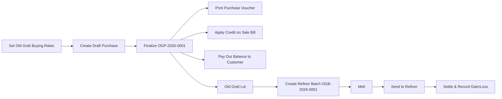

# Amman Jewellers - Old Gold Purchase User Manual

This manual walks you through the complete **Old Gold Purchase** flow in JewelTrackerPro, one
screen at a time: set old gold buying rates, buy old gold or silver from a customer, print the
purchase voucher, apply the purchase as credit on a sale bill (in full or in part), pay out the
remaining balance in cash / UPI / bank, void a payout or cancel a purchase if needed, and move
bought metal through the **Old Gold Lot** and **Refiner Batch** workflow (Melt → Send → Settle).

Every step uses the **same sample shop, rates, customer, old gold purchase, sale bill, payout,
and refiner batch**, so the numbers you see here match what the software shows. You can copy
these examples the first time you practice.

> Dates are shown in the app as `9 Oct 2026` (day, 3-letter month, year). This manual uses the
> same format. Weights are shown to three decimals (milligrams).

> Building a sale bill (Products, HUIDs, GST, and Customer Dues) is covered in the
> [Billing flow user manual](billing-user-manual.md). Redeeming a monthly scheme on a bill is
> covered in the [Gold Savings user manual](gold-savings-user-manual.md).

---

## The sample data used in this manual

### Shop, customer, and rates

| Item | Value |
| --- | --- |
| Shop | Amman Jewellers |
| Date | 9 Oct 2026 |
| Customer | Meenakshi S, mobile `9876543210`, `12, Bazaar Street, Salem` (`CUST-0007`) |
| Refiner (Supplier) | Salem Bullion Refinery |
| 24K Gold selling / buying rate | Rs. 7,640 / g selling · **Rs. 7,500 / g buying** |
| 22K Gold selling / buying rate | Rs. 7,000 / g selling · **Rs. 6,800 / g buying** |
| 20K Gold selling / buying rate | Rs. 6,370 / g selling · **Rs. 6,150 / g buying** |
| 18K Gold selling / buying rate | Rs. 5,730 / g selling · **Rs. 5,500 / g buying** |
| Fine Silver (999) selling / buying rate | Rs. 98 / g selling · **Rs. 92 / g buying** |
| 925 Silver selling / buying rate | Rs. 91 / g selling · **Rs. 0** *(falls back to Rs. 91 / g selling)* |

### The sample Old Gold Purchase (`OGP-2026-0001`)

Meenakshi brings in two old gold ornaments on `9 Oct 2026`:

| Line | Item name | Gross wt | Stone wt | Net wt | Purity | Touch % | Fine wt | Rate / g | Ded % | Gross value | Deduction | Line amount |
| --- | --- | --- | --- | --- | --- | --- | --- | --- | --- | --- | --- | --- |
| 1 | Old Rope Chain | 12.500 g | 0.500 g | 12.000 g | 22K | — | 12.000 g | Rs. 6,800 | 5% | Rs. 81,600.00 | Rs. 4,080.00 | **Rs. 77,520.00** |
| 2 | Old Bangle (assayed) | 10.000 g | 0.000 g | 10.000 g | 22K | 85% | 8.500 g | Rs. 6,800 | 0% | Rs. 57,800.00 | Rs. 0.00 | **Rs. 57,800.00** |
| **Total** | | **22.500 g** | **0.500 g** | **22.000 g** | | | **20.500 g** | | | | | **Rs. 1,35,320.00** |

### How `OGP-2026-0001` is settled across the walkthrough

| Step | Action | Amount | Paid out so far | Applied so far | Balance left |
| --- | --- | --- | --- | --- | --- |
| Finalize purchase | `OGP-2026-0001` finalized | Rs. 1,35,320.00 | Rs. 0.00 | Rs. 0.00 | **Rs. 1,35,320.00** |
| Apply to Tax Invoice `TI-2026-0001` | Partial credit applied on sale bill | Rs. 94,760.00 | Rs. 0.00 | Rs. 94,760.00 | **Rs. 40,560.00** |
| Pay out 1 (Cash) | Counter cash payout on 9 Oct 2026 | Rs. 8,560.00 | Rs. 8,560.00 | Rs. 94,760.00 | **Rs. 32,000.00** |
| Pay out 2 (UPI) | Remaining balance via UPI on 9 Oct 2026 | Rs. 32,000.00 | Rs. 40,560.00 | Rs. 94,760.00 | **Rs. 0.00** |

### The sample Refiner Batch (`OGB-2026-0001`)

The two gold items from `OGP-2026-0001` sit in the **Old Gold Lot** and are sent to the refiner:

| Stage | Date | Details |
| --- | --- | --- |
| **Create (`open`)** | 9 Oct 2026 | 2 Gold items · Gross **22.500 g** · Expected fine **20.500 g** · Cost **Rs. 1,35,320.00** · Refiner: `Salem Bullion Refinery` |
| **Melt (`melted`)** | 10 Oct 2026 | Melted weight: **22.100 g** |
| **Send (`sent`)** | 10 Oct 2026 | Sent weight: **22.050 g** |
| **Settle (`settled`)** | 12 Oct 2026 | Fine weight received: **18.200 g** at Fine rate **Rs. 7,500 / g** (= Rs. 1,36,500.00) + Cash received **Rs. 1,000.00** · Mode: `Cash` |
| **Gain / loss** | | `Rs. 1,000 + (18.200 × Rs. 7,500) − Rs. 1,35,320` = **+Rs. 2,180.00** |

---

## Flow at a glance

---

## Step 1 - Set today's Old Gold Buying Rates

Menu: **Gold & Silver Rates**

Before buying old gold from customers, set your shop's buying rates so every new purchase row
fills in the right rate automatically.

1. Check the **Effective date** at the top of the page (`9 Oct 2026`).
2. Confirm your selling rates under **GOLD** and **SILVER**.
3. Scroll down to the **OLD GOLD BUYING RATES** panel and enter the per-gram buying rates:

   | Card | Sample value | Fallback rule if left at `0` or blank |
   | --- | --- | --- |
   | **24K GOLD BUY** | `7500` | Falls back to `24K GOLD` selling rate (Rs. 7,640) |
   | **22K GOLD BUY** | `6800` | Falls back to `22K GOLD` selling rate (Rs. 7,000) |
   | **20K GOLD BUY** | `6150` | Falls back to `20K GOLD` selling rate (Rs. 6,370) |
   | **18K GOLD BUY** | `5500` | Falls back to `18K GOLD` selling rate (Rs. 5,730) |
   | **FINE SILVER BUY** | `92` | Falls back to `FINE SILVER (999)` selling rate (Rs. 98) |
   | **925 SILVER BUY** | `0` | Falls back to `925 SILVER` selling rate (Rs. 91) |

4. Click **Save rates**. A toast confirms *Metal rates saved*.

> **How the fallback works:** Whenever you pick a purity on an old gold line (`24K`, `22K`, `20K`,
> `18K`, `999`, or `925`), the app checks the matching **BUY** rate first. If that buy rate is
> `0` or blank, it uses the selling rate for that purity. You can also type a custom rate on any
> individual purchase row.

---

## Step 2 - Create an Old Gold Purchase

Menu: **Inventory > Old Gold Purchase**, then click **New purchase** in the top right.

(You can also start a purchase straight from inside a sale bill by clicking **+ New old gold**
in the bill's **Old Gold / Exchange** card — see Step 6.3.)

The **New old gold purchase** modal opens. It has two main sections while creating a purchase,
and a third **Settlement** section once finalized.

### 2.1 Section 1 - Purchase details

The subtitle under **Purchase details** previews the bill number that will be assigned:
`Bill OGP-2026-0001`.

| Field | Sample value | Notes |
| --- | --- | --- |
| **Customer** | Search `Meenak` and pick **Meenakshi S** | Or click **New** inside the search dropdown to add a new customer on the spot. |
| **Date** | `9 Oct 2026` | Defaults to today. Determines the year in `OGP-<year>-<seq>`. |
| **Customer name** | `Meenakshi S` | Auto-filled and locked when a saved customer is selected; editable for walk-in customers. |
| **Phone** | `9876543210` | Auto-filled from the selected customer (10 digits). |
| **Notes** | `2 ornaments brought for exchange` | Optional remark printed on the voucher. |

### 2.2 Section 2 - Purchase items

Each row in the **Purchase items** table represents one lot or ornament brought by the customer.
Click **+ Add item** to add a second row.

Enter our two sample rows:

#### Row 1 — Standard weight & deduction (no touch %)

| Column | Sample input | What happens |
| --- | --- | --- |
| **Item name** | `Old Rope Chain` | Description shown on the voucher and in the Old Gold Lot |
| **G.W** (Gross weight) | `12.500` | Total weight on the scale in grams |
| **St.Wt** (Stone weight) | `0.500` | Weight of stones, wax, or dirt to exclude |
| **Net** (Net weight) | `12.000` | Auto-calculated as `G.W − St.Wt` (`12.500 − 0.500 = 12.000`). You can also override it manually. |
| **Purity** | `22K` | Options: `24K`, `22K`, `20K`, `18K`, `999`, `925`. Picking `999` or `925` marks the item as **Silver**; all others mark it as **Gold**. |
| **Rate/g** | `6800` | Auto-filled from `22K GOLD BUY` when Purity is chosen; editable |
| **Ded %** | `5` | Melting / wastage deduction percentage (`0` to `100`) |
| **Touch %** | leave blank | When blank or `0`, the full Net weight (`12.000 g`) is valued |
| **Fine wt** | *(blank)* | Read-only; shown when Touch % is entered (stored as `12.000 g` fine internally) |
| **Amount** | **Rs. 77,520.00** | Read-only line total |

**How Row 1 is calculated:**
- Valued weight = `12.000 g`
- Gross value = `12.000 × Rs. 6,800` = **Rs. 81,600.00**
- Deduction (5%) = `Rs. 81,600.00 × 5 ÷ 100` = **Rs. 4,080.00**
- Line Amount = `Rs. 81,600.00 − Rs. 4,080.00` = **Rs. 77,520.00**

#### Row 2 — Valued by Touch / Assay %

When an ornament is tested on a touchstone or XRF machine and you want to value it by its
assayed fine content, fill in **Touch %**:

| Column | Sample input | What happens |
| --- | --- | --- |
| **Item name** | `Old Bangle (assayed)` | |
| **G.W** | `10.000` | |
| **St.Wt** | `0` | |
| **Net** | `10.000` | `10.000 − 0 = 10.000` |
| **Purity** | `22K` | |
| **Rate/g** | `6800` | |
| **Ded %** | `0` | |
| **Touch %** | `85` | Assay touch percentage |
| **Fine wt** | `8.500` | Auto-calculated as `Net × Touch % ÷ 100` (`10.000 × 85% = 8.500 g`) |
| **Amount** | **Rs. 57,800.00** | Read-only line total |

**How Row 2 is calculated:**
- Fine (valued) weight = `10.000 × 85 ÷ 100` = **8.500 g**
- Gross value = `8.500 × Rs. 6,800` = **Rs. 57,800.00**
- Deduction (0%) = **Rs. 0.00**
- Line Amount = **Rs. 57,800.00**

At the bottom of the items card, **Old gold total** shows:
- `Rs. 77,520.00 + Rs. 57,800.00` = **Rs. 1,35,320.00**

---

## Step 3 - Save as Draft vs Save & Finalize

At the bottom of the modal you have two save options:

### Option A - Save draft

Click **Save draft**.

- Toast: *Draft saved*.
- The purchase is saved with number `OGP-2026-0001` and status **Draft**.
- On the **Old Gold Purchase** list, the row shows:
  - **Bill no:** `OGP-2026-0001`
  - **Date:** `9 Oct 2026`
  - **Customer:** `Meenakshi S` (`9876543210`)
  - **Items:** `Old Rope Chain · 2 items`
  - **Net wt:** `22.00 g`
  - **Purity:** `22K` (shows `22K/18K` for two purities, or `Mixed` with a hover tooltip when 3+ purities are on the same purchase)
  - **Status:** `Draft`
  - **Applied to:** `—`
  - **Amount:** `Rs. 1,35,320.00`
  - **Paid out:** `Rs. 0.00`
  - **Balance:** `Rs. 1,35,320.00`
- While it is a **Draft**, the row actions are:
  - **Edit** (pencil icon) — reopen and change items, weights, rates, or customer.
  - **Finalize** — convert the draft into a final purchase.
  - **Delete** (trash icon) — permanently delete the draft (*"Delete draft? This purchase has not been applied to a sale bill."*).

> **Draft guard:** A draft purchase **cannot** be applied to a sale bill, paid out, or added to a
> refiner batch. If you type a draft number into a sale bill, the app stops you with:
> *"`OGP-2026-0001` is still a draft. Finalize it before applying to a sale bill."*

### Option B - Finalize the purchase

You can finalize either:
- From inside the editor by clicking **Save & finalize**, **or**
- From the list row by clicking **Finalize**.

#### Finalize from inside the editor (`Save & finalize`)

A **Finalize old gold purchase?** dialog opens:
- Explains: *"Finalizing records this purchase so it can be applied to a sale bill or paid out. It does not add stock to Purchase. A finalized purchase cannot be edited."*
- Offers a convenience tick box: **"Pay the balance out to the customer now"**.
  - If you tick it, **Mode** (`Cash`, `UPI`, `Bank / cheque`) and **Amount** (defaults to the full total `135320`) appear right inside the dialog so you can finalize and pay the customer in a single click (recorded with note `Paid at finalize`).
  - For our sample walkthrough, leave **"Pay the balance out to the customer now" unticked** and click **Finalize**, because Meenakshi wants to use most of the credit on a new jewellery purchase first.

#### What happens when `OGP-2026-0001` is finalized

| Item | Result |
| --- | --- |
| Status | Moves from **Draft** to **Final** |
| Toast | *Old gold purchase finalized* |
| Balance | **Rs. 1,35,320.00** available to apply on bills or pay out |
| Retail / Inward stock | **Unchanged** — Old Gold Purchase never adds items to **Products** or **Purchase (Inwards)** |
| Old Gold Lot | Both items (`Old Rope Chain` 12.000 g net and `Old Bangle (assayed)` 10.000 g net) immediately appear in **Inventory > Old Gold Lot** under **Gold** |
| Row actions on list | **Pay out** (wallet icon), **Print** (printer icon), **View** (eye icon), and **Cancel** (ban icon, shown while unused) |

---

## Step 4 - Print or save the Old Gold Purchase Voucher

Once a purchase is finalized:

1. On the **Old Gold Purchase** list, click the **Print** (printer) icon on `OGP-2026-0001` (or open the purchase with the **View** icon and click **Print** in the footer).
2. The **Print preview** modal opens for `/print/old-gold-purchase/<id>`.
3. Click **Print** to send it to your printer, or **PDF** to download `old-gold-purchase.pdf`.

### What the printed voucher shows

- **Header:** Shop logo, shop name (`Amman Jewellers`), address, phone numbers, and GSTIN.
- **Title:** `OLD GOLD PURCHASE VOUCHER`
- **Left meta (`Received From`):** Customer name (`Meenakshi S`), phone (`9876543210`), address, and ID proof / Aadhaar / PAN if saved on the customer profile.
- **Right meta:** `Bill No` (`OGP-2026-0001`), `Date` (`9 Oct 2026`), and `Status` (`Final` or `Cancelled`).
- **Items table:** `S.No`, `Item`, `Gross`, `Stone`, `Net`, `Purity`, `Rate/g`, `Ded %`, and `Amount`.
- **Settlement summary box:**
  - `Total net weight`: `22.000 g`
  - `Purchase amount`: `135320.00`
  - `Paid to customer`: `0.00` (updates as payouts are recorded)
  - `Applied to bills`: `0.00` (updates as bills are linked)
  - `Balance`: `135320.00`
- **Payouts table** *(shown automatically once any payout is recorded)*: `Date`, `Mode`, `Amount`, `Note`.
- **Applied to bills table** *(shown automatically once linked to any bill)*: `Bill No`, `Date`, `Status`, `Amount`.
- **Footer:** Notes (`2 ornaments brought for exchange`) and signature lines (`Customer signature` and `For Amman Jewellers`).

---

## Step 5 - Apply the Old Gold Purchase to a Sale Bill

Meenakshi now buys a **Rope Chain** and a **Lakshmi Ring** on a Tax Invoice (`TI-2026-0001`) on
`9 Oct 2026` whose invoice total with GST is **Rs. 94,760.00** (from the
[Billing flow user manual](billing-user-manual.md)).

Menu: **Billing > Tax Invoice > New Tax Invoice**, select customer **Meenakshi S**, and add the
sale items totaling **Rs. 94,760.00**.

Scroll to the **Old Gold / Exchange** card on the bill editor. There are **three ways** to attach
old gold to a sale bill:

### 5.1 Way 1 - Pick from "Finalized old gold for this customer" (fastest)

Because **Meenakshi S** is selected on the bill, the **Old Gold / Exchange** card automatically
lists every finalized purchase of hers that still has a balance:

| Bill no | Info shown | Action |
| --- | --- | --- |
| `OGP-2026-0001` | `9 Oct 2026 · Rs. 1,35,320.00 left` | **Apply** |

Click **Apply**.

### 5.2 Way 2 - Type the Old Gold bill number (`Add`)

In the **Old gold bill no** box:
- You can type the full number `OGP-2026-0001` (upper or lower case), **or**
- Just type the sequence digits `1` or `0001` — the app matches the newest `OGP-<year>-0001` automatically.
- Click **Add**.

> **Different customer check:** If you look up an `OGP-` number that belongs to a different
> customer than the one on the sale bill, a confirmation dialog appears:
> *"`OGP-2026-0001` belongs to `<name>`, but this bill is for `<bill customer>`. Apply it anyway?"*
> Click **Apply anyway** to proceed, or **Cancel** to back out.

### 5.3 Way 3 - Buy old gold directly inside the sale bill (`+ New old gold`)

If the customer brings old gold to the billing counter and you haven't created an Old Gold
Purchase yet:
1. Click **+ New old gold** inside the **Old Gold / Exchange** card on the bill.
2. The **New old gold purchase** modal opens with the bill's customer (`Meenakshi S`) already pre-filled.
3. Enter the old gold items and click **Save & finalize** → **Finalize**.
4. The newly finalized `OGP-` bill is **automatically linked** to the sale bill you are editing!

---

### 5.4 How the applied amount and remaining balance work on the bill

When `OGP-2026-0001` (balance **Rs. 1,35,320.00**) is applied to our Tax Invoice (invoice total
**Rs. 94,760.00**):

1. The app automatically caps the default applied amount to the **smaller** of:
   - the purchase's available balance (`Rs. 1,35,320.00`), and
   - the amount the bill still needs (`Rs. 94,760.00`).
2. The **Old Gold / Exchange** table on the bill shows:

   | Bill no | Customer | Amount (editable) | Balance left | Actions |
   | --- | --- | --- | --- | --- |
   | `OGP-2026-0001` | Meenakshi S | `94760` | **Rs. 40,560.00** | **Wallet** (Pay out balance) · **Trash** (Remove) |

3. In the right-hand **Bill Summary** panel:

   | Summary line | Amount |
   | --- | --- |
   | Subtotal | Rs. 92,220.00 |
   | Discount | − Rs. 220.00 |
   | Taxable | Rs. 92,000.00 |
   | CGST 1.5% + SGST 1.5% | Rs. 2,760.00 |
   | **Invoice total** | **Rs. 94,760.00** |
   | **Old gold exchange** | **− Rs. 94,760.00** |
   | **Amount Payable** | **Rs. 0.00** |

4. Click **Finalize** on the sale bill. The bill becomes `TI-2026-0001` with status **PAID**
   (`Rs. 0.00` payable), and `OGP-2026-0001` now has:
   - **Applied to bills:** `Rs. 94,760.00` (`TI-2026-0001`)
   - **Balance left:** `Rs. 40,560.00`

> **Editing the applied amount:** You can type a smaller number in the **Amount** box on the link
> row (for example `50000`) if the customer only wants to use part of their old gold credit on
> this bill and save the rest (`Rs. 85,320.00`) for a second bill or a payout. You can even split
> one `OGP-` purchase across **multiple sale bills** as long as the total applied + paid out does
> not exceed the purchase amount.

---

## Step 6 - Pay out the remaining balance to the customer

After applying `Rs. 94,760.00` to `TI-2026-0001`, Meenakshi still has **Rs. 40,560.00** left on
`OGP-2026-0001`.

You can open the **Pay out `OGP-2026-0001`** modal from two places:
- **Right inside the sale bill editor** (before finalizing the bill): click the **Wallet** icon
  (`Pay out balance of OGP-2026-0001`) on the link row in the **Old Gold / Exchange** table, **or**
- **From Inventory > Old Gold Purchase**: click the **Wallet** icon on the `OGP-2026-0001` row.

### 6.1 Worked example — Payout 1 (Counter Cash: Rs. 8,560.00)

Click the **Wallet** icon on `OGP-2026-0001`. The **Pay out OGP-2026-0001** modal shows:
*"Meenakshi S sold this old gold. Balance available Rs. 40,560.00 of Rs. 1,35,320.00."*

| Field | Sample value | Notes |
| --- | --- | --- |
| **Date** | `9 Oct 2026` | Defaults to today |
| **Mode** | `Cash` | `Cash` / `UPI` / `Bank / cheque` |
| **Amount** | `8560` | Defaults to the full remaining balance (`40560`); edited to `8560` here |
| **Note** | `Counter cash paid` | Optional |

Click **Record payout**.
- Toast: *Payout recorded*.
- **Paid out** becomes **Rs. 8,560.00**, and **Balance** drops to **Rs. 32,000.00**.

### 6.2 Income Tax Section 40A(3) cash warning (Rs. 10,000 or more)

If you select **Mode: `Cash`** and enter an **Amount of `10000` or more**, the modal displays an
amber compliance warning before you save:

> *"A cash payout of Rs. 32,000.00 may need the customer's PAN, and cash above Rs 10,000 a day is
> restricted under section 40A(3)."*

This is an advisory warning (it does not block saving if you still choose Cash), reminding the
cashier to record the customer's PAN or use **UPI** / **Bank / cheque** for larger payouts.

### 6.3 Worked example — Payout 2 (UPI: Rs. 32,000.00)

Click the **Wallet** icon on `OGP-2026-0001` again to pay the remaining balance:

| Field | Sample value |
| --- | --- |
| **Date** | `9 Oct 2026` |
| **Mode** | `UPI` |
| **Amount** | `32000` |
| **Note** | `UPI ref 628391048291` |

Click **Record payout**.
- **Paid out** is now `Rs. 8,560.00 + Rs. 32,000.00` = **Rs. 40,560.00**.
- **Applied to bills** is **Rs. 94,760.00** (`TI-2026-0001`).
- **Balance** is now **Rs. 0.00**, and the **Wallet** icon disappears from the row because the
  purchase is fully settled.

---

## Step 7 - View Settlement History, Void a Payout, or Cancel a Purchase

### 7.1 View full settlement details

On **Inventory > Old Gold Purchase**, click the **View** (eye) icon on `OGP-2026-0001`.
Scroll to **Section 3 - Settlement**:

| Summary metric | Value |
| --- | --- |
| **Purchase amount** | Rs. 1,35,320.00 |
| **Paid out** | Rs. 40,560.00 |
| **Applied to bills** | Rs. 94,760.00 |
| **Balance** | Rs. 0.00 |

Below the summary cards are two history tables:
- **Applied to bills:** lists `TI-2026-0001` · `9 Oct 2026` · `Rs. 94,760.00` (if a linked bill is still a draft, the Bill no column shows `Draft bill`).
- **Payouts:** lists each payout with `Date`, `Mode` (`CASH`, `UPI`, `BANK`), `Amount`, `Note`, and a **Void** button.

### 7.2 Void a payout (if a payout was recorded by mistake)

If a payout was entered with the wrong amount or mode:
1. Open the purchase with the **View** (eye) icon and scroll to **Payouts**.
2. Click **Void** on the payout row you want to reverse.
3. The **Void payout?** dialog asks:
   *"Void the Rs. 8,560.00 payout on OGP-2026-0001? The amount returns to the purchase balance."*
4. Type a **Reason** (for example `Entered wrong mode`) and click **Void payout**.
5. Toast: *Payout voided*. The payout row stays in the audit history marked `Voided: Entered wrong mode`, and `Rs. 8,560.00` is immediately restored to the purchase's **Balance**.

### 7.3 What happens if a linked Sale Bill is cancelled?

If you later cancel `TI-2026-0001` (from the Billing page), the cancellation automatically
releases the `Rs. 94,760.00` link on `OGP-2026-0001`. That `Rs. 94,760.00` returns to the
purchase's **Balance** so it can be applied to a replacement bill or paid out.

### 7.4 Cancel an Old Gold Purchase

If a finalized Old Gold Purchase was recorded in error, you can cancel it so the voucher number
is kept for audit but marked void:

1. Make sure the purchase has:
   - **no active sale bill links** (remove it from any draft bill, or cancel the finalized sale bill first),
   - **no active payouts** (void any payouts first), and
   - **no items in an active or settled refiner batch** (cancel the refiner batch first).
2. On **Inventory > Old Gold Purchase**, the **Cancel** (ban) icon appears on the row whenever
   there are no bill links and no active payouts. Click it.
3. In the **Cancel OGP-2026-...?** dialog, type a **Reason** (for example `Recorded twice`) and
   click **Cancel purchase**.
4. Status becomes **Cancelled**, Balance shows `—`, and the purchase is excluded from totals,
   reports, and the Old Gold Lot.

---

## Step 8 - The Old Gold Lot and Refiner Batches

Menu: **Inventory > Old Gold Lot**

When you buy old gold or silver from customers, those ornaments do **not** go into your retail
**Products** catalog. Instead, every item from a **finalized** Old Gold Purchase enters the
**Old Gold Lot** so you can batch it, melt it, send it to a refiner, and record the settlement.

> **Important:** Every finalized purchase item appears in the **Old Gold Lot** until it is put into
> a refiner batch — even if the customer's rupee credit on that purchase was applied to a sale bill!
> The rupee credit settles the customer; the physical metal sits in your Old Gold Lot until melted
> and refined.

### 8.1 Review the Old Gold Lot

At the top of **Inventory > Old Gold Lot**, summary stat cards group unbatched items by metal:

| Stat card | Sample value |
| --- | --- |
| **Gold lot · 2 items** | `22.500 g · Rs. 1,35,320.00` |

Below that, the **Unbatched items** card lists every unbatched item:

| Purchase | Date | Customer | Item | Metal | Gross (g) | Net (g) | Fine (g) | Purity | Cost |
| --- | --- | --- | --- | --- | --- | --- | --- | --- | --- |
| `OGP-2026-0001` | 9 Oct 2026 | Meenakshi S | Old Rope Chain | Gold | 12.500 g | 12.000 g | 12.000 g | 22K | Rs. 77,520.00 |
| `OGP-2026-0001` | 9 Oct 2026 | Meenakshi S | Old Bangle (assayed) | Gold | 10.000 g | 10.000 g | 8.500 g | 22K | Rs. 57,800.00 |

### 8.2 Step 8a - Create a Refiner Batch (`Open`)

A refiner batch can only hold items of **one metal** (`Gold` or `Silver`). Once you tick a Gold
item, any Silver items are automatically disabled (and vice versa).

1. Click **Select all Gold** (or tick the two checkboxes manually).
   The header shows: `2 selected · 22.500 g`.
2. Click **Create refiner batch**.
3. The **Create refiner batch** modal shows the batch summary:
   *"2 items of Gold · 22.500 g gross · 20.500 g fine · Rs. 1,35,320.00 cost."*
4. Fill in:

   | Field | Sample value | Notes |
   | --- | --- | --- |
   | **Batch date** | `9 Oct 2026` | Determines the year in `OGB-<year>-<seq>` |
   | **Refiner** | `Salem Bullion Refinery` | Pick from your saved Suppliers (`Inventory > Suppliers`), or leave `Not set` |
   | **Notes** | `October lot 1` | Optional |

5. Click **Save**.
   - Toast: *Refiner batch updated*.
   - The items leave the **Unbatched items** table (`The lot is empty`).
   - A new row `OGB-2026-0001` appears in the **Refiner batches** table with status **Open**.

### 8.3 Step 8b - Melt the Batch (`Open` → `Melted`)

When the ornaments are melted into a bar/kachcha piece:

1. On the `OGB-2026-0001` row in **Refiner batches**, click **Melt**.
2. In the **Melt OGB-2026-0001** modal, fill in:

   | Field | Sample value | Notes |
   | --- | --- | --- |
   | **Melt date** | `10 Oct 2026` | |
   | **Melted weight (g)** | `22.100` | Defaults to the batch's gross weight (`22.500`); enter the weight after melting loss |
   | **Notes** | `0.400 g loss in crucible` | Optional (appends/updates batch notes) |

3. Click **Save**. The batch status changes from **Open** to **Melted**.

### 8.4 Step 8c - Send to the Refiner (`Melted` → `Sent`)

When the melted bar is handed over or dispatched to the refiner:

1. On the `OGB-2026-0001` row, click **Send**.
2. In the **Send OGB-2026-0001 to refiner** modal, fill in:

   | Field | Sample value | Notes |
   | --- | --- | --- |
   | **Sent date** | `10 Oct 2026` | |
   | **Sent weight (g)** | `22.050` | Defaults to the melted weight (`22.100`); enter the weight after sample cut if any |
   | **Notes** | `Handed to refiner representative` | Optional |

3. Click **Save**. The batch status changes from **Melted** to **Sent**.

### 8.5 Step 8d - Settle the Batch (`Sent` → `Settled`)

When the refiner settles the batch (with fine bullion, cash, bank transfer, or a mix):

1. On the `OGB-2026-0001` row, click **Settle**.
2. The modal displays the reference line at the bottom:
   *"Expected fine weight 20.500 g · cost Rs. 1,35,320.00."*
3. Fill in the **Settle OGB-2026-0001** fields:

   | Field | Sample value | Notes |
   | --- | --- | --- |
   | **Settled date** | `12 Oct 2026` | |
   | **Fine weight received (g)** | `18.200` | Defaults to expected fine weight (`20.500`); enter actual fine gold credited/received |
   | **Fine rate (₹/g)** | `7500` | The 24K fine rate used to value the fine weight received |
   | **Cash received (₹)** | `1000` | Any extra cash / bank amount received alongside or instead of fine metal |
   | **Settlement mode** | `Cash` | `Cash` / `Bank` / `Fine metal` |
   | **Notes** | `Settled in 999 fine + Rs. 1,000 cash` | Optional |

4. Click **Save**. The batch status changes to **Settled**.

#### How Gain / Loss is calculated on a settled batch

$$\text{Gain / Loss} = \text{Cash received} + (\text{Fine weight received} \times \text{Fine rate}) - \text{Cost amount}$$

For `OGB-2026-0001`:
- Value of fine weight received = `18.200 g × Rs. 7,500 / g` = **Rs. 1,36,500.00**
- Plus cash received = `+ Rs. 1,000.00` = **Rs. 1,37,500.00** total settlement value
- Minus original purchase cost = `− Rs. 1,35,320.00`
- **Gain / loss** = **+Rs. 2,180.00** (shown in green on the batch row; a negative number is shown in red).

> **Does settling a refiner batch change Gold & Silver stock?**
> **No.** Received fine weight on a refiner batch is for settlement and gain/loss tracking only —
> it never adds to **Inventory > Gold & Silver** or **Inventory > Purchase**.

### 8.6 Cancel a Refiner Batch (before settlement)

While a batch is in **Open**, **Melted**, or **Sent** status (before it is **Settled**), a
**Trash** icon appears in the Action column:
1. Click the **Trash** icon on the batch row.
2. The **Cancel OGB-2026-0001** modal explains:
   *"Cancelling releases all 2 items back to the lot. This is only possible before the batch is settled."*
3. Enter a **Reason** (for example `Wrong refiner selected`) and click **Cancel batch**.
4. The batch is marked **Cancelled** and all of its items immediately return to **Unbatched items**
   in the Old Gold Lot.

---

## Step 9 - Where Old Gold appears across the app

### 9.1 Dashboard

Menu: **Dashboard**

The daily KPI strip includes an **Old gold bought** card for the selected date:
- **Main value:** Today's finalized old gold purchase total (`₹ 1,35,320`).
- **Hint line:** Today's total net weight bought and the total open (unsettled) balance across all finalized purchases (`22.000 g · open ₹ 0`).

### 9.2 Customer Profile

Menu: **Customers**, then click **Meenakshi S**.

Her profile tracks all of her finalized Old Gold Purchases alongside her sale bills and dues:
- Summary metrics for **Old Gold Amount**, **Old Gold Net Weight**, and **Old Gold Open Balance**.
- A row for `OGP-2026-0001` showing the date (`9 Oct 2026`), net weight (`22.000 g`), purchase amount (`Rs. 1,35,320.00`), paid out (`Rs. 40,560.00`), balance (`Rs. 0.00`), and status (`Final`).

### 9.3 Reports

Menu: **Reports**

Five built-in reports cover Old Gold Purchases, payouts, and the refiner lot (all exportable to CSV / Print):

| Report title | Group | Filters | What it shows |
| --- | --- | --- | --- |
| **Old Gold Purchase Register** | Purchase | Date range, Customer, Metal | One row per finalized purchase (`Date`, `Purchase`, `Customer`, `Metal`, `Net (g)`, `Fine (g)`, `Amount`, `Paid out`, `Applied`, `Balance`) with column totals. |
| **Old Gold Purity Summary** | Metal | Date range, Customer, Metal | Grouped by `Metal` and `Purity`: `Items` count, `Gross (g)`, `Net (g)`, `Fine (g)`, and `Amount`. |
| **Old Gold Payouts** | Payment | Date range, Customer | Every non-voided payout (`Date`, `Purchase`, `Customer`, `Mode`, `Amount`, `Invoice`, `Note`) with total paid out. |
| **Old Gold Lot** | Stock | Metal | Current unbatched items sitting in the lot (`Purchase`, `Date`, `Customer`, `Item`, `Metal`, `Purity`, `Gross (g)`, `Net (g)`, `Fine (g)`, `Cost`). |
| **Daily Business Summary** | Sales / Daily | Date range | Includes `Old Gold Bought` and `Old Gold Paid Out` columns for each day. |

---

## Common messages and what to do

| Message | What it means | What to do |
| --- | --- | --- |
| *Enter a customer name* | Customer name is blank on the purchase form | Pick a customer or type a walk-in customer name |
| *Add at least one old gold item with weight* | Every row has 0 gross/net weight | Enter gross weight (and stone weight if any) so net weight is above 0 |
| *`OGP-...` is still a draft. Finalize it before applying to a sale bill.* | You tried to link a draft purchase on a sale bill | Open **Inventory > Old Gold Purchase** and click **Finalize** on that purchase first |
| *`OGP-...` is cancelled* | You tried to link or pay out a cancelled purchase | Use an active finalized purchase instead |
| *`OGP-...` is already on this bill* | You tried to add the same purchase twice to the same bill | Edit the **Amount** column on the existing link row instead |
| *`OGP-...` is already applied to `TI-...`* / *has no balance left to apply* | The purchase's entire balance is already used up | Pick a purchase that still has a balance, or create a new old gold purchase |
| *This bill is already covered by old gold. Reduce a link before adding another.* | The sale bill's payable amount is already `Rs. 0.00` | Reduce the amount on an existing old-gold link if you want to split across two purchases |
| *Only `Rs. X` is left on this purchase* / *Payout cannot exceed the balance of `X` on `OGP-...`* | The payout or bill link amount is larger than the remaining balance | Enter an amount equal to or less than the remaining balance |
| *A cash payout of `Rs. ...` may need the customer's PAN, and cash above Rs 10,000 a day is restricted under section 40A(3).* | Cash payout is Rs. 10,000 or more | Switch Mode to **UPI** or **Bank / cheque**, or ensure the customer's PAN is recorded |
| *Only draft old gold purchases can be modified* | You tried to edit a finalized or cancelled purchase | Finalized purchases are locked; cancel and re-create if needed |
| *Only a finalized purchase can be cancelled. Delete a draft instead.* | You tried to cancel a draft | Use the **Delete** (trash) icon on a draft |
| *This purchase is applied to a sale bill. Cancel that bill first.* | You tried to cancel a purchase linked to a bill | Remove the link from the draft bill, or cancel the finalized sale bill first |
| *This purchase has a payout. Void the payout first.* | You tried to cancel a purchase that has an active payout | Open **View** (eye icon) → **Payouts** → click **Void** on each active payout first |
| *This purchase has items in a refiner batch. Remove them from the batch first.* | You tried to cancel a purchase whose items were batched | Go to **Inventory > Old Gold Lot** and cancel the refiner batch (if not yet settled) |
| *A batch can only hold items of a single metal* | Gold and Silver items were mixed in one batch request | Create one batch for Gold items and a separate batch for Silver items |
| *`OGB-...` is settled. Cannot cancel it.* | You tried to cancel a refiner batch after settling it | Settled batches are permanent |

---

## Quick reference

### Purchase statuses (`OGP`)

| Status | Meaning |
| --- | --- |
| **Draft** | Saved, editable, can be deleted. Cannot be applied to a bill, paid out, or batched. |
| **Final** | Locked and active. Voucher can be printed; balance can be applied to sale bills or paid out; items enter the Old Gold Lot. |
| **Cancelled** | Reversed with a reason. Number stays used for audit; balance is `—`; excluded from lots and reports. |

### Refiner batch statuses (`OGB`)

| Status | Meaning | Next action |
| --- | --- | --- |
| **Open** | Items grouped into a batch and removed from the unbatched lot | **Melt** (or **Cancel**) |
| **Melted** | Melted weight and melt date recorded | **Send** (or **Cancel**) |
| **Sent** | Sent weight and sent date recorded for the refiner | **Settle** (or **Cancel**) |
| **Settled** | Fine weight received, fine rate, and cash received recorded; **Gain / loss** computed | Final state (cannot be cancelled) |
| **Cancelled** | Batch cancelled before settlement; items returned to the unbatched lot | Final state |

### Number formats

| Document | Format | Sample |
| --- | --- | --- |
| Old Gold Purchase | `OGP-<year>-<seq>` | `OGP-2026-0001` |
| Refiner Batch | `OGB-<year>-<seq>` | `OGB-2026-0001` |
| Tax Invoice (linked sale bill) | `TI-<year>-<seq>` | `TI-2026-0001` |
| Quotation / Cash Bill (linked sale bill) | `CB-<year>-<seq>` | `CB-2026-0001` |

### Key formulas

| Calculation | Formula | Sample (`OGP-2026-0001` / `OGB-2026-0001`) |
| --- | --- | --- |
| **Net weight** | $\text{Gross weight} - \text{Stone weight}$ | $12.500 - 0.500 = 12.000\text{ g}$ |
| **Valued (Fine) weight** | $\text{Net weight} \times \frac{\text{Touch \%}}{100}$ *(if Touch % > 0, else Net weight)* | $10.000 \times 85\% = 8.500\text{ g}$ |
| **Gross value** | $\text{Valued weight} \times \text{Rate per gram}$ | $12.000 \times 6,800 = \text{Rs. }81,600.00$ |
| **Deduction amount** | $\text{Gross value} \times \frac{\text{Deduction \%}}{100}$ | $81,600 \times 5\% = \text{Rs. }4,080.00$ |
| **Line amount (Final value)** | $\text{Gross value} - \text{Deduction amount}$ | $81,600 - 4,080 = \text{Rs. }77,520.00$ |
| **Purchase balance** | $\text{Purchase amount} - \text{Paid out (non-voided)} - \text{Applied to bills}$ | $1,35,320 - 40,560 - 94,760 = \text{Rs. }0.00$ |
| **Refiner batch gain / loss** | $\text{Cash received} + (\text{Fine wt received} \times \text{Fine rate}) - \text{Cost amount}$ | $1,000 + (18.200 \times 7,500) - 1,35,320 = +\text{Rs. }2,180.00$ |

### Keys to remember

- **Set Old Gold Buying Rates first** on **Gold & Silver Rates**; any buying rate left at `0` automatically falls back to the selling rate.
- **Finalize before using:** A purchase must be **Final** before it can reduce a sale bill, be paid out, or enter the Old Gold Lot.
- **One purchase, flexible settlement:** You can split a single `OGP-` purchase across multiple sale bills and multiple payouts (Cash, UPI, Bank) in any combination until its balance reaches `Rs. 0.00`.
- **Never pollutes retail stock:** Buying old gold and settling refiner batches never add to **Products** or **Gold & Silver** stock.
- **Reversible when needed:** Voiding a payout or cancelling a linked sale bill immediately restores the credit to the Old Gold Purchase's balance; cancelling a refiner batch before settlement returns its items to the Old Gold Lot.
